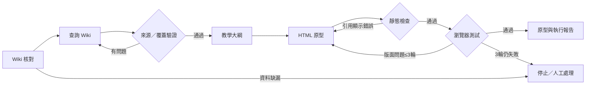

# STEP 4｜可執行 Graph＋局部 Loop

## 工作目的及執行狀態

本專案沿用已 ingest 的六份統計學講義所建立的 **六篇 Wiki 條目**，建立「Wiki 引用 → 證據卡 → 教學大綱 → HTML 原型 → 檢查與記錄」的工作流程。這個版本**已有可執行的 Python 程式與 HTML 原型**，不是只有文字構想。

> 注意：本步驟的 `slides/workflow-preview.html` 是**流程與檢查原型**，不是完成獨立內容審查的最終教學簡報。正式版留到 STEP 5。程式驗證不能代替對原始講義的內容審查。

## Graph 節點：各關卡可讀、可輸出、可退回

| 節點 | 輸入 | 實際輸出 | 檢查標準 | 未通過處理 |
|---|---|---|---|---|
| **A Wiki 核對** | `wiki/entries/`、六份來源卡及來源登記表 | `reports/audit_wiki.json` | 至少五份來源已 ingest；引用 ID/頁次有效；來源卡及索引存在 | **停止**。來源或 Wiki 未完成不能跳關 |
| **B 查詢 Wiki → 證據卡** | `workflow/lesson_spec.json`、Wiki 條目 | `workflow/artifacts/cards/01.json`～`12.json`；`evidence_cards.json` | 每個教學主張都能找到原 Wiki 段落及來源標記 | 錨點找不到 → 回 B 重查；不得猜測內容 |
| **C 來源／覆蓋檢查** | 證據卡、source_registry | `workflow/artifacts/coverage.json` | 至少五份來源；所有引用對應真實 ID 和 PDF 頁次 | 錯誤 → 回 B；仍無資料則停止 |
| **D 教學大綱** | 通過 C 的證據卡 | `workflow/artifacts/outline.md` | 12 頁，先基礎再推論；有段落與來源對照 | 內容空缺 → 回 B；教學順序錯誤 → 修 D |
| **E HTML 原型** | 已選定證據卡與大綱 | `slides/workflow-preview.html` | HTML 只引用 Wiki 已存在的文字，不在渲染時發明統計事實 | 可修 CSS、輸出引用樣式，不得改動統計敘述 |
| **F 靜態檢查** | HTML、Wiki、來源清冊 | `reports/workflow/static_validation.json` | 10–12 頁、所有 Wiki 連結與引用存在、來源 ID ≥5、導航元素完整 | 排版／引用顯示問題回 E；內容來源不存在回 B |
| **G 瀏覽器檢查** | HTML | `reports/workflow/browser_validation.json`、桌面／手機截圖 | Chromium 1280×800 和 390×844、前後按鈕、每頁是否溢出 | 版面問題只回 E，最多 **3 輪**；仍失敗停止 |
| **H 產出紀錄** | A–G 各節點結果 | `reports/workflow/graph_execution.json`、`graph-run-log.md` | 結果如實記錄通過、失敗、停止與未驗證項目 | 內容忠實度未獨立審查 → 明示「待 STEP 5」 |

## Graph 圖

原始圖在 [design.mmd](design.mmd)。



## Loop 的五件事（對應講義第 21–23 頁）

1. **目標**：把已有的統計 Wiki 生成可閱讀、可引用的教學 HTML 原型。
2. **限制**：不得使用未經核實的外部統計事實；不能修改原始 PDF；Wiki 原段落與檔案架構不得自動覆蓋；不能把自編例題標示成講義原題。
3. **完成標準**：機器稽核通過、六來源可追溯、HTML 頁數 10–12、靜態連結無誤、桌機與手機版面及導覽可操作；**獨立統計忠實度審查仍須另行完成**。
4. **停止條件**：缺乏來源或遇到未解的來源矛盾就停止；局部排版修正達到三輪仍不合格也停止；不會無限制重新生成整份簡報。
5. **觸發條件**：執行 `python workflow/run_graph.py` 時觸發；日後更新 Wiki 或教學主題，也可以重新執行。

### 真正具體的局部 Loop

- 本機 runner 對 **E→G 版面問題**最多嘗試三次，僅縮小字體尺度以改善溢出，重新輸出 HTML 後再測試；保持證據卡及統計敘述不變。
- **B/C 內容來源錯誤**不允許靠縮字級或擅自改寫補救，停下並將問題交給使用者或上游資料節點。
- 執行紀錄會真實呈現實際修正輪數；第一輪順利通過就是 1 輪，**不會為了作業分數假造失敗三輪**。

## 如何在自己的電腦重跑

使用 Python 3.10 以上：

```bash
cd Statistics-LLM-Wiki-Step4
python workflow/run_graph.py
```

- 前半段（Wiki、證據卡、大綱、HTML 輸出、靜態檢查）使用 Python 標準函式庫。
- 如要自動執行 Chrome 畫面檢查，需另外安裝 Playwright、Chromium；若未安裝，程式會標明 `browser_pending`，**不會假稱通過**。
- 若要核對來源 PDF 雜湊，請在本機私有 `raw/` 裡放回原始講義，再執行 `python scripts/check_sources.py`。公開 ZIP 不包含教師 PDF；沒有原始 PDF 時 `audit_wiki.py` 會明確跳過雜湊驗證。
- 檔案原型可直接開啟 `slides/workflow-preview.html` 瀏覽，使用上下頁按鈕或左右方向鍵。

## 紀錄與反思（只用實際發生的問題）

- [最終成功跑完的執行記錄](../reports/workflow/graph-run-log.md)
- [第一次失敗執行](../reports/workflow/graph_attempt1_failed.md)：當時 HTML 只顯示兩個來源標記，但檢查預期保留四個，靜態檢查確實失敗，修復位置在 E 渲染，而不是亂改 Wiki。
- [追加修改時的第三次失敗執行](../reports/workflow/graph_attempt3_failed.md)：為改善 Z 分數說明而修改來源錨點，卻因 Wiki 原文含有 LaTeX 標記，造成錨點不吻合；已把檢查退回 B 重新比對原文並修正。這是來源匹配問題，不是新的統計資料矛盾。
- [第二次失敗執行](../reports/workflow/graph_attempt2_failed.md)：渲染器的檔案 URL 被執行環境限制，改以 `page.set_content()` 提供渲染內容後才完成畫面測試。**這是測試環境問題，不是 HTML 網站本身的內容錯誤。**
- [最終靜態檢查](../reports/workflow/static_validation.json)、[Chromium 測試結果](../reports/workflow/browser_validation.json)
- [尚待人工審查](../reports/workflow/manual-review.md)：尤其有三個 Wiki 段落的引文位於相鄰解說段，而不在段落本身。已確認引用 ID 存在，但仍須人工確認其語意對應。

> Graph 控制節點間的去向，局部 Loop 只處理**被檢查報告指出的具體缺陷**。較好的設計是「錯誤在靠近來源的地方被攔下」，而不是做完 HTML 才發現原始數據有問題。


## STEP 5｜在 STEP 4 Graph 後加入正式教學 HTML 和驗證

- `workflow/build_final_deck.py` 從 STEP 4 的 `evidence_cards.json` 與來源清冊建立正式 12 頁簡報；教學案例在程式中明確列出，必須對應 Wiki。
- `workflow/check_final_deck.py` 用來源 ID／頁次／Wiki 標記、連結和算術驗證構成「來源及內容形式」關卡。
- `workflow/check_final_deck_browser.py` 驗證桌機及手機 24 個頁面視圖、來源面板、目錄與鍵盤操作；失敗則退回 HTML CSS，不允許動統計主張。
- `workflow/run_final_graph.py` 可從 Wiki 核對到正式 HTML 的每個節點重新跑，結果寫 `reports/step5/run_final_graph.md`。
- 真正修正案例：首次手機檢視時 `flex:0` 導致內容重疊，僅修改版面再測試；其他卡片、來源、公式不變。詳細見 `reports/step5/visual-iteration.md`。
- 最終狀態仍是 `ready_for_user_review`，因為原始講義的獨立內容審查及 GitHub 公開網址測試尚未完成。
